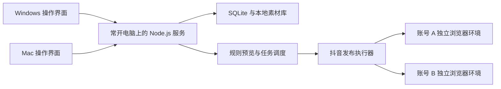

# 抖音个人发布工具：技术方案讨论稿 v0.1

此稿为历史方案。根据后续确认的单机运行、文件夹组稿与配置迁移需求，当前方案见 [v0.2](./technical-proposal-v0.2.md)。

更新日期：2026-10-12。状态：需求讨论；尚未开始实现或验证实际账号发布。

## 已确认需求

- 个人自用，第一版只接入抖音，可能管理多个账号。
- Windows 与 macOS 两台电脑使用；此前的“iOS”实际指 Mac，手机端暂不需要。
- 优先 Node.js，支持用户自定义发布规则。
- 优先本地部署，可以让一台电脑常开。
- 浏览器账号环境需要保存，同时希望各账号隔离。

## 推荐架构

一台常开电脑运行 Node.js 本地服务，集中保存素材、草稿、规则、任务和账号浏览器环境；Windows 与 Mac 均通过网页访问。主机可以是 Windows 或 Mac，具体选择待确认。

主机和客户端可以在同一台电脑。第二台电脑上传文件到主机，任务不能只引用第二台电脑的本地路径。客户端关闭网页后，主机上的任务可以继续；主机关机、休眠或断网时无法继续发布。重启后核对未完成任务；过期排期采用用户配置的补发、跳过或人工确认策略。

第一版只设一个实际发布主机。将来确需两台电脑独立执行时，再增加执行器注册、任务租约和各设备分别登录。跨平台运行不等于浏览器配置目录可在两个操作系统之间直接搬移并保留登录。

## 技术栈建议

| 层 | 推荐 | 用途 |
|---|---|---|
| 语言与项目 | TypeScript、Node.js LTS、pnpm workspace | 界面、服务和执行器共用类型 |
| 界面 | React、Vite、Ant Design | 账号列表、图文/视频编辑、规则表单、任务状态 |
| 服务 | Fastify、Zod | HTTP API、配置校验、设备登录 |
| 数据 | SQLite、Drizzle | 单主机存储草稿、规则版本、账号元信息与任务 |
| 发布执行 | Playwright、Chromium；按实际兼容性评估 Chrome channel | 登录、填写、上传、确认及结果核对 |
| 任务 | SQLite 持久化任务表、单执行器调度循环 | 重启恢复、排期、同账号串行锁 |
| 素材 | 主机本地目录、内容哈希、流式上传 | 跨设备使用统一素材，避免依赖客户端路径 |
| 图片与视频 | Sharp；有转码需求时使用 FFmpeg | 图片处理、视频规格检查与可选转码 |
| 打包 | 第一版启动脚本；需要安装包和托盘时增加 Electron | 保留 Node.js 技术路线，减少初版打包工作 |

SQLite 数据库只由主机服务访问，放在主机本地磁盘。两台电脑通过 API 协作，不把数据库文件放在网盘或网络共享目录中同时读写。见 [SQLite 网络使用说明](https://www.sqlite.org/useovernet.html)。

局域网访问加入登录认证。若需要跨网络访问，再选择私有组网或其他明确的远程连接方案，不默认开放公网端口。浏览器登录环境和发布日志不进入 Git；常规备份包含数据库、素材与规则，浏览器环境的恢复需要单独验证。

## 多账号浏览器策略

推荐每个账号一个专用持久化浏览器目录，使用 Playwright `launchPersistentContext(userDataDir)`。它保留 Cookie 和网站存储；浏览器不允许多个实例同时占用同一目录，所以发布、手动登录和人工接管使用同一账号锁。专用目录与日常 Chrome 环境分开。见 [Playwright 持久化环境文档](https://playwright.dev/docs/api/class-browsertype#browser-type-launch-persistent-context)。

无痕环境适合一次性隔离，但它默认不持久保存完整会话。无痕环境配合导入、导出 `storageState` 可以恢复部分身份状态，仍不等价于完整浏览器环境，不能默认保存所有会话数据。见 [Playwright 身份状态说明](https://playwright.dev/docs/auth) 和 [隔离说明](https://playwright.dev/docs/browser-contexts)。

本项目首先解决账号不串用和环境保留。独立目录、无痕或自动化工具均不能保证平台不触发验证。登录、验证码与二次确认出现时暂停，由用户操作。首版建议使用可见浏览器，便于核对和接管。

## 抖音接入路线与开源项目

抖音开放平台的视频发布接口需要申请权限和用户授权，提交后还有审核过程；是否适用于用户账号，需要核实资格与实际权限。见 [抖音创建视频文档](https://open.douyin.com/platform/resource/docs/openapi/video-management/douyin/create/create-video/)。

根据用户提出的多账号浏览器环境需求，优先做创作者网页发布流程的可行性验证。验证成功后封装独立 Node.js 抖音适配器，发布步骤、页面判断和结果查询集中在该模块维护。

| 项目 | 调研结论 | 本项目用途 |
|---|---|---|
| [social-auto-upload](https://github.com/dreammis/social-auto-upload) | 当前 README 列出抖音图文、视频和定时；MIT；主线为 Python CLI 和上传模块，历史 Web 端不保证当前可运行 | 参考抖音流程与异常处理；Node.js 偏好下不直接整套使用 |
| [Postiz](https://github.com/gitroomhq/postiz-app) | Next.js/NestJS 等完整社媒管理系统；AGPL-3.0；渠道与部署更偏海外平台场景 | 参考编辑与任务设计；仅抖音本地 MVP 不建议作为底座 |
| [Wechatsync](https://github.com/wechatsync/Wechatsync) | 偏文章与图片同步的 Chrome 扩展；GPL-3.0；部分适配器为私有子模块 | 第一版优先级低，不假定全部宣传平台源码可复用 |

这些是仓库与文档调研结果，尚未用用户账号验证成功率。复用源码前检查对应文件许可证；网页发布流程变化需要持续维护。Wechatsync 的子模块情况见 [.gitmodules](https://github.com/wechatsync/Wechatsync/blob/v2/.gitmodules)。

## 自定义规则

第一版采用可视化表单配合结构化 JSON 配置，规则结构为“条件、动作、优先级、冲突策略”。先支持用户确认的实际规则，再扩展高级脚本。

候选规则示例，均待用户确认：

- 指定账号使用专属文案模板、话题或发布时段。
- 图文与视频采用不同标题、封面及素材校验规则。
- 同一素材在同一账号发布前提示重复；可允许明确的再次发布。
- 发布成功后给素材加状态标签；移动原文件必须明确来源、目标和失败处理。

规则执行后展示最终文案、话题、素材、目标账号及命中规则。每次确认任务固定稿件版本与规则版本，后续修改不悄悄改变已确认任务。平台硬限制不能被个人规则覆盖。

## 发布可靠性

- 发布到每个账号分别建立任务，保存目标账号与内容版本。
- 同账号发布和环境操作串行；初版全局并发保守设置为 1。
- 发布前核对浏览器当前登录账号与目标账号，避免发错账号。
- 上传失败与最终提交失败分别处理。
- 最终提交后若连接中断，标记“结果待确认”，先核对平台结果，避免直接重发。
- 状态至少区分待确认、待执行、执行中、等待人工、已提交待审核、已发布、失败、结果待确认。
- 保存可获得的平台内容 ID、链接与时间；提交成功不直接等同于审核通过、公开可见。

## 建议开发顺序与多智能体分工

1. 明确主机、网络、账号数量、内容类型、规则和排期要求。
2. 先验证一个账号：打开独立浏览器、用户登录、重启后复用环境、上传图文/视频、核对预览。实际公开发布由用户明确授权后做端到端验证。
3. 固定 API、任务状态和目录约定，再分模块并行实现。
4. 前端智能体负责账号、素材、编辑、规则与任务界面。
5. 后端智能体负责 SQLite、素材上传、规则、任务与恢复。
6. 发布智能体负责抖音适配、账号环境和人工接管；主智能体集成、审查与验收。
7. 验收覆盖账号不串用、浏览器重启后登录可用、两电脑共享素材、规则预览、结果不确定时不盲目重发；Windows 和 Mac 都需要实际运行验证。

## 待确认需求

1. 两台电脑是否同一局域网？哪台常开？是否经常需要异地访问？
2. 第一版图文和视频是否都需要？是否需要定时自动发布？
3. 预计账号数量，以及最需要的 2–3 条自定义规则。
4. 是否需要导入本地目录批量发布？视频典型大小、时长和格式。
5. 是否仅需统一网页界面，还是第一版就要求 Windows/macOS 安装包。
6. 登录及验证码在主机上完成是否方便？异地人工接管需求另行设计。
